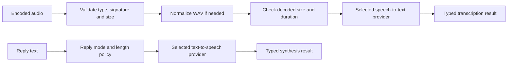

# CasCap.Api.Voice

Speech-to-text and text-to-speech pipelines for .NET 10 applications. Use provider-neutral
transcription and synthesis contracts while selecting Whisper, Azure or Piper behind dependency injection.

## Installation

```powershell
dotnet package add CasCap.Api.Voice
```

## Usage

Register either pipeline in a .NET Generic Host:

```csharp
using CasCap.Abstractions;
using CasCap.Models;
using Microsoft.Extensions.DependencyInjection;
using Microsoft.Extensions.Hosting;

var builder = Host.CreateApplicationBuilder(args);
builder.Services.AddSpeechToText();
builder.Services.AddTextToSpeech();

using var host = builder.Build();
var transcription = host.Services.GetRequiredService<IVoiceTranscriptionService>();
var result = await transcription.Transcribe(
    await File.ReadAllBytesAsync("input.wav"), "audio/wav");

if (result.TranscriptAvailable)
{
    var synthesis = host.Services.GetRequiredService<IVoiceSynthesisService>();
    var reply = await synthesis.TrySynthesizeAsync(
        "The request is complete.", inboundWasVoice: true);

    if (reply.Outcome == VoiceSynthesisOutcome.Success)
        await File.WriteAllBytesAsync("reply.ogg", reply.Audio.ToArray());
}
```

Provide a reachable transcription backend. Synthesis returns `Skipped` until its mode is enabled;
with the Piper configuration below it produces Ogg Opus audio. The example's transcription input is
a local WAV file, not an audio fixture shipped in the package.

[`IVoiceTranscriptionService`](https://github.com/f2calv/CasCap.Api.Voice/blob/main/src/CasCap.Api.Voice/Abstractions/IVoiceTranscriptionService.cs)
and [`IVoiceSynthesisService`](https://github.com/f2calv/CasCap.Api.Voice/blob/main/src/CasCap.Api.Voice/Abstractions/IVoiceSynthesisService.cs)
are in `CasCap.Abstractions`; configuration,
enums and result records are in `CasCap.Models`. Check `TranscriptAvailable` or `AudioAvailable`
before consuming content. Validation, limits and provider failures produce typed outcomes; caller
cancellation propagates rather than becoming a successful result.

## Providers

| Direction | Provider | Required backend |
| --- | --- | --- |
| Transcription | `WhisperAsr` (default) | openai-whisper-asr-webservice HTTP endpoint |
| Transcription | `WhisperCpp` | whisper.cpp `whisper-server` HTTP endpoint |
| Transcription | `Azure` | Azure AI Speech resource and host-supplied token credential |
| Synthesis | `AzureSpeech` (default) | Azure AI Speech resource and host-supplied token credential |
| Synthesis | `AzureOpenAi` | Azure OpenAI audio deployment and host-supplied token credential |
| Synthesis | `Piper` | Wyoming TCP server and ffmpeg with `libopus` |

`AzureSpeechContainer`, `Kokoro` and `CoquiXtts` are enum values, not supported adapters; selecting one
for enabled synthesis throws `NotImplementedException` when the provider client is resolved.
Audio or text is transmitted to the selected backend, including a cloud service when an Azure
provider is selected. The library does not deploy that backend.

## Configuration

The host supplies configuration through normal .NET providers:

| Section | Important settings and defaults |
| --- | --- |
| `CasCap:SpeechToTextConfig` | `Provider=WhisperAsr`, `WhisperAsrEndpoint=http://localhost:9000`, `Language=en`, `TimeoutMs=120000`, `Mode=Disabled` |
| `CasCap:TextToSpeechConfig` | `Mode=Disabled`, `Provider=AzureSpeech`, `MaxCharacters=1000`, `TimeoutMs=60000` |
| `CasCap:VoiceMetricsConfig` | `MetricNamePrefix=voice` |

Transcription accepts up to 5 MiB compressed, 19,200,000 decoded bytes and 300 seconds of audio.
Configure `MaxCompressedBytes`, `MaxDecodedBytes` and `MaxDurationSeconds` independently; all must
pass. Supported containers include WAV, AAC, MP3, MP4/M4A, Ogg/Opus and FLAC, with matching file
signatures. Non-normalized input requires ffmpeg and is converted to 16 kHz mono signed 16-bit PCM WAV.
Conversion uses pipes, not temporary files. One transcription runs per service instance; its timeout
includes admission, conversion and the backend request.

`SpeechToTextConfig.Mode` communicates `Disabled`, `Shadow` or `Enabled` to a consuming host's
orchestration. A direct `Transcribe` call does not inspect that mode: the host must gate its own
receive, processing and reply paths. The library itself contains no agent or messaging workflow.

`TextToSpeechConfig.Mode` is enforced by synthesis: `Disabled` skips, `MatchInbound` speaks only
when `inboundWasVoice` is true, and `Always` permits any reply. Empty or non-speakable text is skipped;
normalized text over `MaxCharacters` returns `TooLong`.

For Azure transcription set `AzureEndpoint`; for Azure Speech synthesis set `AzureSpeechEndpoint`.
For Azure OpenAI set `AzureOpenAiEndpoint`, `AzureOpenAiDeployment` and a service-supported
`AzureOpenAiApiVersion` (the code defaults to `2025-03-01-preview`). The host supplies
`IOptions<AzureAuthConfig>` with a `TokenCredential`; these registration methods do not acquire one.
Provider-specific voice settings are `AzureSpeechVoice`, `AzureOpenAiVoice` or `PiperVoice`.

Set either pipeline's `FfmpegPath` when `ffmpeg` is not on `PATH`. See the
[runtime requirements](https://github.com/f2calv/CasCap.Api.Voice/blob/main/README.md#runtime-requirements)
before choosing an application image.

## Configuration Examples

### Default transcription, no spoken replies

```json
{
  "CasCap": {
    "SpeechToTextConfig": {
      "Provider": "WhisperAsr",
      "WhisperAsrEndpoint": "http://localhost:9000"
    },
    "TextToSpeechConfig": {
      "Mode": "Disabled"
    }
  }
}
```

### whisper.cpp transcription and Piper replies

```json
{
  "CasCap": {
    "SpeechToTextConfig": {
      "Provider": "WhisperCpp",
      "WhisperCppEndpoint": "http://localhost:8080",
      "Mode": "Enabled",
      "Language": "en",
      "MaxCompressedBytes": 5242880,
      "MaxDecodedBytes": 19200000,
      "MaxDurationSeconds": 300,
      "TimeoutMs": 120000,
      "FfmpegPath": "ffmpeg"
    },
    "TextToSpeechConfig": {
      "Mode": "MatchInbound",
      "Provider": "Piper",
      "PiperEndpoint": "localhost:10200",
      "MaxCharacters": 1000,
      "TimeoutMs": 60000,
      "FfmpegPath": "ffmpeg"
    },
    "VoiceMetricsConfig": {
      "MetricNamePrefix": "voice"
    }
  }
}
```

Piper uses `host:port`, not an HTTP URL. Supply real remote endpoints and credentials through
secret-backed configuration.

## Data Flow



The two pipelines are independent; the host decides whether a transcript should lead to a reply.

## Diagnostics and Testing

The transcription meter is named by `MetricNamePrefix`. Instruments use
`<prefix>.voice.transcriptions`, `<prefix>.voice.audio.duration`, and duration/speed measurements for
transcoding and transcription. Dimensions are bounded provider/outcome values, not media names,
recordings or transcripts. Exporter registration belongs to the consuming host.

Provider adapters implement Microsoft.Extensions.AI
[`ISpeechToTextClient`](https://github.com/dotnet/extensions/blob/main/src/Libraries/Microsoft.Extensions.AI.Abstractions/SpeechToText/ISpeechToTextClient.cs)
and [`ITextToSpeechClient`](https://github.com/dotnet/extensions/blob/main/src/Libraries/Microsoft.Extensions.AI.Abstractions/TextToSpeech/ITextToSpeechClient.cs).
Registrations use `TryAdd`, so applications can replace the clients or whole pipelines. Use the
[Testing companion](https://github.com/f2calv/CasCap.Api.Voice/blob/main/src/CasCap.Api.Voice.Testing/README.md)
for canned clients without a speech backend.

## License

Released under the [MIT License](https://github.com/f2calv/CasCap.Api.Voice/blob/main/LICENSE).
